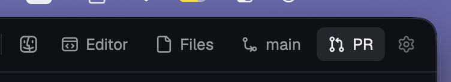

# herdr-toolkit

Review and ship agent work without leaving [Herdr](https://herdr.dev).

herdr-toolkit is a slim layout for the Herdr desktop app. It keeps Herdr's own window (spaces and
agents on the left, tabs, panes as cards, status bar) and adds a side panel for files, changes,
pull requests and issues, plus a handful of tab bar buttons.

<p align="center">
  
</p>

<p align="center">
  <sub>The tab bar: Finder, Editor, Files, Changes (showing the branch), PR and settings.</sub>
</p>

It borrows the best parts of [Kanso](https://github.com/jlopezlira/herdr-kanso) and
[Mission Control](https://github.com/CiprianSpiridon/herdr-mission-control) without their whole
layouts: no pane strip, no new sidebar, no tracker setup.

**[Read the guide](docs/GUIDE.md)** for every feature, the settings, workflows and troubleshooting.

## Contents

- [Quick install](#quick-install)
- [What you get](#what-you-get)
- [Keys](#keys)
- [Install, update and remove](#install-update-and-remove)
- [What it runs](#what-it-runs)
- [Credits and license](#credits-and-license)

## Quick install

1. Have the [Herdr desktop app](https://herdr.dev) open, plus `git` and `python3`. For the PR and
   Issues panels, install the [GitHub CLI](https://cli.github.com) and run `gh auth login`.
2. Clone and install:

   ```sh
   git clone https://github.com/thabti/herdr-toolkit
   cd herdr-toolkit
   scripts/install.sh
   ```

3. Switch to the layout:

   ```sh
   herdr-app do layout.switch --name sab
   ```

4. Open **herdr-toolkit settings** (`⌘⌥,`) to turn features on or off.

`ctrl-shift-l` takes you back to your previous layout.

## What you get

### A side panel that follows your pane

Click **Files**, the branch name, **PR** or **Issues** in the tab bar to open the panel on the
right. It follows the pane you're in, so each session sees its own repository.

| Panel | What it shows |
|---|---|
| **Files** | A tree of the pane's folder with git marks beside each file. |
| **Changes** | The working tree's changes, with diffs and Commit. Its tab bar button shows the current branch. |
| **PR** | Every open pull request, with labels, comments, checks, unresolved threads, reviewers, files and diffs, and merge. |
| **Issues** (off by default) | The repository's open GitHub issues, grouped and filterable. |

- **Hand work to your agent.** From a pull request, one click starts a **Code review**,
  **Describe change**, **Explain**, **Address feedback** or **Resolve conflicts** task in a new
  tab. From an issue, **Start** puts your agent on it.
- **Many repositories at once.** In a folder of repositories (not one itself), Changes shows each
  repository in its own section, with a filter chip per repository, and commits to the one you
  pick. A repository with **worktrees** shows each worktree the same way.
- **Create PR** beside Commit pushes the branch and opens a draft pull request from its commits.
- **Several `gh` accounts.** Each repository is read with the logged-in account that can see it,
  found automatically. The account menu in the panel header switches it per repository or adds
  one.

### A tab bar that tells you more

- **Tabs that name themselves.** An unnamed tab shows the Jira key its branch carries (`DS-1234`)
  or its agent's own title. A name you type always wins.
- **Claude Code context %** on each Claude tab, from its status line. An idle agent keeps its last
  reading, dimmed, with its age in the tooltip.
- **gcloud login at a glance.** A chip shows whether you're logged in and to which project. A
  small button runs `gcloud auth login`.

### Shortcuts out of Herdr

- **Finder and your editor.** The Finder button opens the focused pane's folder in Finder. `⌘⇧O`
  or the **Editor** button opens the pane's folder, or a file from Files, in Cursor, VS Code, Zed,
  Windsurf, Sublime, a JetBrains IDE, Xcode, or Neovim, Helix or Vim in a split.
- **Jira everywhere.** Set your site and every key like `DS-1234` links to its ticket: on tabs
  (`⌘⌥J`), pull request titles, branches, descriptions and comments, issues, and Markdown
  previews.

### Settings for all of it

**herdr-toolkit settings** sits under Herdr's own **Settings** in the sidebar, and behind the gear
in the tab bar. Every feature can be turned off or tuned there. Changes apply live and are saved to
`~/.config/herdr-app/sab.json`.

## Keys

| Keys | What they do |
|---|---|
| `⌘⇧O` | Open the focused pane's folder in an editor |
| `⌘⌥,` | herdr-toolkit settings |
| `⌘⌥G` | `gcloud auth login` in a new tab |
| `⌘⌥J` | Open the tab's Jira ticket |
| Double-click a tab, or `F2` | Name it (empty: back to the automatic name) |

## Install, update and remove

You need the Herdr desktop app, `git`, `python3`, and the [GitHub CLI](https://cli.github.com)
(`gh auth login`) for the PR and Issues panels. `gcloud` is optional.

| To | Run |
|---|---|
| Preview the install (changes nothing) | `scripts/install.sh --dry-run` |
| Install | `scripts/install.sh` |
| Install into another Herdr home | `HERDR_APP_HOME=/path scripts/install.sh` |
| Update | `git pull && scripts/install.sh` |
| Remove | `scripts/install.sh --remove` |

- The installer copies the layout and 5 mods into `~/.config/herdr-app`, adds 4 keys, and runs
  `herdr-app check` on each mod.
- It never overwrites files it didn't install, and it leaves keys you already use alone.
- Herdr reloads the mods live after an update.
- Removing deletes everything the installer added. Your settings in
  `~/.config/herdr-app/sab.json` stay.

## What it runs

| Command | Used for |
|---|---|
| `git`, `find` | Files and Changes |
| `gh` | PR and Issues, only while that panel is shown |
| `gcloud` | `config list`, `auth list`, and `auth print-access-token` for the login check |
| `open`, `sh` | Finding and starting editors |

It reads files only in the folders you work in, plus your Claude Code status-line snapshot.

The PR panel can change GitHub when you click: merge (it asks twice), close, draft, labels,
assignees and reviewers.

## Credits and license

Apache License 2.0. See [LICENSE](LICENSE) and [NOTICE](NOTICE).

- The panels and Open with are derived from Kanso by jlopezlira (Apache-2.0), which grew from the
  mods shipped with Herdr.
- The tab bar and sidebar footer start from Herdr's shipped `tabs` and `workspace-chrome`.
- Self-naming tabs and Claude context readings are ideas from Mission Control.

Each derived file's header says what changed.
